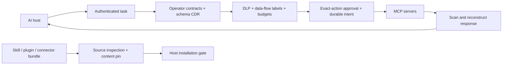

# tool-gateway

[](https://github.com/manasa1508/tool-gateway/actions/workflows/ci.yml)
[](LICENSE)

A policy gateway between AI hosts and untrusted integrations. It mediates MCP
traffic in both directions and checks skill, plugin and connector source bundles
before installation. Go implementation; one runtime dependency; no inference
service, database, Python backend or external detector API.

**Release 0.1:** functional, tested security infrastructure, with a deliberately
bounded compatibility profile. Independent security review and deployment-specific
containment remain necessary before sensitive production use. Detection is
heuristic; policy enforcement provides the stronger boundary.



## What is implemented

| Boundary | Enforcement |
| --- | --- |
| Tool identity | Operator allowlists, server-qualified aliases, full raw-definition SHA-256 pins, immediate pre-call revalidation |
| Model-visible contracts | Discard server descriptions, titles, annotations and extension metadata; substitute operator descriptions and rebuild structural input schemas |
| Prompt injection | Weighted RE2 rules; NFKC normalization, invisible-format removal, bounded percent/Base64 decoding; scan arguments, metadata and full response objects |
| Credentials | Reject recognized credentials in outbound arguments **and inbound responses**, including audit mode |
| Data flow | Accumulating task-level labels; every next tool must accept every label already exposed to the task |
| Sensitive actions | Offline Ed25519 approvals bound to principal, task, server, tool, exact argument digest, policy digest, expiry and a one-use nonce |
| Evidence | Private, exclusive-writer JSONL journal; chained hashes, fsync before action, persistent replay prevention, external checkpoint verification |
| Reliability | Frame/depth/page/session/call/output limits, deadlines, backpressure, dead-upstream circuits, graceful shutdown and no automatic action retries |
| More MCP surfaces | Reviewed resources and prompts, checked arguments and text-only result reconstruction; reverse sampling, elicitation and roots requests disabled |
| Integration artifacts | Deterministic source-bundle manifests with file hashes and executable bits, symlink/binary/size rejection, content scanning and operator pins |
| Operations | Authenticated metrics, readiness/liveness endpoints, hardened container and Kubernetes examples, CI, adversarial tests and fuzz targets |

This builds on use cases demonstrated by [Kevlar](https://github.com/Ablation-Tool/kevlar).
The particular additions here are operator-owned capability contracts, conservative
cross-tool information flow, exact-action approvals and integration-bundle checks
sharing the same scanner. These are useful engineering choices, not a claim that
the underlying techniques have never been built. See [research](docs/research.md).

## Run the local demonstration

Requires Go **1.27.3+** on Linux or macOS, and Python 3 only for black-box tests.

```sh
make build
./bin/tool-gateway demo-policy --out policy.local.json
./bin/tool-gateway check --policy policy.local.json
./bin/tool-gateway stdio --policy policy.local.json
```

Configure an MCP host to launch the last command using absolute paths:

```json
{
  "mcpServers": {
    "tool-gateway": {
      "command": "/absolute/path/tool-gateway/bin/tool-gateway",
      "args": ["stdio", "--policy", "/absolute/path/tool-gateway/policy.local.json"]
    }
  }
}
```

The generated policy runs a harmless local demo server. `read_note` labels the
task `internal`; after reading it, `send_message` is blocked because the sink's
contract does not accept internal information. The message sink is a no-op.
`make e2e` verifies this with the real compiled processes, plus HTTP and DLP.

For an authenticated HTTP gateway:

```sh
export TOOL_GATEWAY_TOKEN="$(openssl rand -hex 32)"
./bin/tool-gateway serve --policy policy.local.json
```

The endpoint is `http://127.0.0.1:8844/mcp`. Every request needs the bearer token.
Initialize once, retain `Mcp-Session-Id`, send `notifications/initialized`, and
include `MCP-Protocol-Version: 2025-11-25` thereafter. Public ingress must provide
TLS. The gateway token is never used as an upstream credential.

## Bring a real server under policy

1. Capture and review its complete `tools/list` response in an isolated environment.
2. Run `tool-gateway inspect --file tools.json` for definition pins, schema support
   and detector findings. Inspect does not execute the server or approve its code.
3. Add the executable or fixed HTTPS endpoint, explicit environment passthrough,
   tool allowlists, operator descriptions and data labels to a policy. Use
   [the example](examples/policy.json) and [policy reference](docs/policy.md).
4. Begin in `audit` with synthetic data. Review findings and false positives.
5. Pin reviewed definitions and switch to `strict`; restart to load the new policy.

| Mode | Injection rejection | Registry changes on explicit re-list |
| --- | --- | --- |
| strict | Score ≥ 40 | Frozen after first list; reviewed pins mandatory |
| lenient | Score ≥ 80 | Allowed within operator contracts; configured pins enforced |
| audit | Scores do not reject | Allowed within operator contracts; configured pins enforced |

Authentication, DLP, schema safety, approvals, data-flow policy, limits and audit
availability remain enforced in **all** modes. Audit records metadata and findings,
not raw payloads or credentials. List-change notifications are not forwarded;
non-strict clients must explicitly re-list to discover approved changes.

## Approvals, source bundles and evidence

```sh
# Keep the private key outside the gateway runtime and repository.
tool-gateway keygen --private-key /secure/operator-approval.key

# After reviewing args.json and the gateway's returned task/action fingerprint:
tool-gateway approve --policy policy.json --private-key /secure/operator-approval.key \
  --task TASK_ID --server payments --tool create_invoice --args args.json --ttl 2m

# Inspect; then pin the returned bundle root in policy.artifacts.
tool-gateway artifact --root ./reviewed-skill --kind skill
tool-gateway artifact --root ./reviewed-skill --kind skill --id report-skill --policy policy.json

# Verify against a head retained independently of the journal.
tool-gateway verify-audit --file audit.local.jsonl --head EXPECTED_FINAL_HASH

# Compare scanner modes against a JSONL corpus without invoking any tools.
tool-gateway simulate --file examples/corpus.jsonl
```

Pass the returned approval in tool call `params._meta["io.toolgateway/approval"]`.
The private signing key is never loaded by `serve` or `stdio`. An approval cannot
override DLP, schema validation, a data-flow denial or an exhausted budget.

## Compatibility and limits

The implemented MCP profile is **2025-11-25**: stdio and Streamable HTTP with JSON
responses, including upstream SSE response consumption. HTTP GET streams, legacy
HTTP+SSE, images/audio/blobs/resource links, tasks, completions, subscriptions,
arbitrary extensions and server-initiated requests are disabled. Safe text from
embedded resources is reconstructed as plain text. Unsupported content is dropped;
an all-unsupported response becomes a protocol error. Structured JSON tool results
are scanned and preserved; server output schemas are not advertised or enforced.

MCP **2026-07-28** changed the protocol to per-request negotiation. This release
explicitly rejects that profile rather than applying handshake assumptions to it.
See [compatibility](docs/compatibility.md). Artifact checks are installation
preflight controls; a host must run the check on an immutable snapshot and install
that same snapshot. They do not intercept arbitrary plugin execution.

The gateway cannot see direct calls that bypass it, stop a server's own network
traffic, or prove that the implementation behind a stable tool definition is safe.
Local subprocesses need OS/container sandboxing and network restrictions. See the
[threat model](docs/threat-model.md) and [operations guide](docs/operations.md).

## Development

```sh
make check
make fuzz
make e2e
go mod verify
go run golang.org/x/vuln/cmd/govulncheck@v1.9.0 ./...
docker build -t tool-gateway:local .
```

See [architecture and stack rationale](docs/architecture.md),
[validation](docs/validation.md), [deployment](deploy/README.md), and [security](SECURITY.md).
